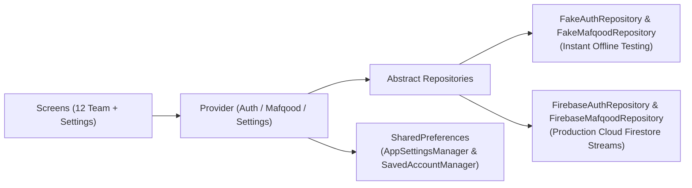

<div align="center">

# 🔍 مفقود | Mafqood

**منصة محلية ذكية للمفقودات والمعثورات — Smart Local Lost & Found Platform**

[](https://flutter.dev)
[](https://dart.dev)
[](https://firebase.google.com)
[](https://pub.dev/packages/provider)
[](#%EF%B8%8F-architecture--folder-structure)

**Package / Application ID:** `com.mafqoodteam.mafqood`

</div>

---

## 💡 نظرة عامة | Overview

**مفقود (Mafqood)** هو تطبيق موبايل محلي يربط بين الأشخاص الذين فقدوا ممتلكاتهم الشخصية (محافظ، هواتف، مفاتيح، شنط، بطاقات) والأشخاص الذين عثروا عليها، باستخدام **خوارزمية مطابقة ذكية (Smart Matching)**، و**محادثة آمنة داخل التطبيق (Safe Chat)** دون كشف البيانات الشخصية، و**إشعارات فورية**، بالإضافة إلى **لوحة تحكم للإدارة (Admin Dashboard)**.

---

## ✨ المميزات الرئيسية | Key Features

| الميزة | الوصف |
| :--- | :--- |
| 📝 **الإبلاغ السريع (Lost & Found)** | إنشاء بلاغ مفقود أو معثور عليه بالنوع، الفئة، اللون، الوصف، الموقع، التاريخ، والصورة. |
| 🔎 **البحث والفلترة الفورية** | بحث بالكلمات المفتاحية أو الموقع مع Filter Chips للفئات (`wallet`, `phone`, `keys`, `bag`, `cards`, `other`). |
| 🤖 **المطابقة الذكية (Smart Matching)** | مقارنة تلقائية بين بلاغات المفقودات والمعثورات وإظهار نسبة التطابق (مثل `92% Match`) مع تنبيه فوري للطرفين. |
| 💬 **الشات الآمن (Safe Chat)** | محادثة ثنائية في الوقت الفعلي لتنسيق تسليم المفقودات دون مشاركة أرقام الهواتف أو البيانات الحساسة. |
| 🔔 **مركز الإشعارات** | تنبيهات فورية مصنفة زمنياً (**اليوم / أمس**) عند وجود تطابق جديد، رسالة جديدة، أو اعتماد بلاغ. |
| 🛡️ **لوحة تحكم الإدارة (Admin)** | متابعة إحصائيات البلاغات النشطة والمكتملة والمعلقة، مع صلاحية الموافقة أو الحذف. |
| 🌍 **ثنائي اللغة والثيمين** | دعم كامل للعربية (`RTL`) والإنجليزية (`LTR`) بخط `Cairo`، مع **Light & Dark Mode** وحفظ التفضيلات محلياً. |

---

## 🎨 الهوية البصرية | Design System

| العنصر | Light Mode | Dark Mode | الاستخدام |
| :--- | :--- | :--- | :--- |
| **Primary (Navy)** | `#1A2B4C` | `#0F172A` | الهوية الأساسية وخلفيات الداكن |
| **Accent (Turquoise)** | `#0D9488` | `#14B8A6` | الأزرار، الشارات، والتفاصيل التفاعلية |
| **Semantic (Lost / Found)** | `#EF4444` / `#10B981` | `#EF4444` / `#10B981` | تمييز بلاغات المفقود والمعثور عليه |
| **Typography** | `Cairo` (`google_fonts`) | `Cairo` (`google_fonts`) | خط موحد واضح للعربية والإنجليزية |

---

## 🏛️ Architecture & Data Flow

يعتمد المشروع على **Repository Pattern + Provider** مع فصل كامل بين واجهات المستخدم (`screens/`) ومصادر البيانات (`data/`):



### هيكل المجلدات (`lib/`)

```text
lib/
├── main.dart                         # App entry point, Providers & MaterialApp setup
├── core/
│   ├── data/mock_data_provider.dart  # Realistic bilingual mock data for instant testing
│   ├── localization/app_strings.dart # Arabic (RTL) & English (LTR) string helpers
│   ├── models/                       # AppUser, ReportItem, MatchResult, ChatMessage, AppNotification
│   └── theme/                        # app_colors.dart & app_theme.dart (Material 3 + Cairo)
├── data/
│   ├── local/                        # AppSettingsManager & SavedAccountManager
│   └── repositories/                 # auth_repository.dart & mafqood_repository.dart
├── navigation/
│   ├── app_routes.dart               # Centralized named routes
│   ├── app_router.dart               # Route generator connecting all screens
│   └── main_app_shell.dart           # 4-tab Bottom Navigation Shell
├── ui/widgets/                       # AppScreenContainer, AppCard, ReportCard
└── screens/
    ├── auth_mahmoud/                 # Mahmoud Abo El-Nady (4 screens)
    ├── reports_abdelrahman/          # Abdelrahman Mohamed (4 screens)
    ├── smart_yousef/                 # Yousef Mohamed El-Basuony (4 screens)
    └── settings/                     # Shared SettingsScreen
```

---

## 🤖 آلية المطابقة الذكية | Smart Matching Logic

عند إنشاء أي بلاغ جديد عبر `MafqoodRepository.createReport(report)`:
1. يتم البحث في البلاغات المعتمدة من النوع المقابل (`Lost` ↔ `Found`).
2. يتم حساب درجة التطابق بناءً على:
   - **تطابق الفئة (`category`):** وزن أساسي مرتفع.
   - **تطابق اللون (`color`):** تعزيز الدقة البصرية.
   - **تقارب الموقع (`location`):** مطابقة الكلمات المشتركة في المنطقة.
   - **تشابه العنوان/الوصف (`title`):** كلمات مفتاحية مشتركة.
3. إذا تجاوزت النسبة الحد الأدنى، يتم إنشاء `MatchResult` تلقائياً وإرسال `AppNotification` فوري لكلا الطرفين.

---

## 👥 فريق العمل وتوزيع المهام | Team & Branches

| العضو | الدور | البرانش | المسار والشاشات |
| :--- | :--- | :--- | :--- |
| **يوسف محمد البسيوني**<br>*(Yousef Mohamed El-Basuony)* | Team Lead, Architecture & Smart Backend | `Joo` | `lib/screens/smart_yousef/`<br>• `smart_matches_screen.dart`<br>• `safe_chat_screen.dart`<br>• `admin_dashboard_screen.dart`<br>• `notifications_screen.dart` |
| **عبدالرحمن محمد**<br>*(Abdelrahman Mohamed)* | Reports & Search UI + Backend Co-developer | `Tana7` | `lib/screens/reports_abdelrahman/`<br>• `home_feed_screen.dart`<br>• `report_item_screen.dart`<br>• `item_details_screen.dart`<br>• `search_filter_screen.dart` |
| **محمود أبو النادي**<br>*(Mahmoud Abo El-Nady)* | Auth & Profile UI | `AboElnady` | `lib/screens/auth_mahmoud/`<br>• `splash_screen.dart`<br>• `login_screen.dart`<br>• `register_screen.dart`<br>• `my_profile_screen.dart` |

> **الشاشة المشتركة:** `lib/screens/settings/settings_screen.dart` — إدارة الإشعارات، الثيم، اللغة، التبديل السريع بين الحسابات المحفوظة، وقسم About الفريق.

---

## 🚀 التشغيل السريع | Getting Started

```bash
# 1. Install dependencies
flutter pub get

# 2. Verify static analysis (0 issues)
flutter analyze

# 3. Run on emulator or connected device
flutter run

# 4. Build Debug APK
flutter build apk --debug
```

### تفعيل وضع الإنتاج (Firebase)
التطبيق يعمل افتراضياً عبر `FakeAuthRepository` و `FakeMafqoodRepository` لتجربة كل المزايا فوراً بدون إعداد مسبق. للربط بـ Firebase الحقيقي:
1. أضف `google-services.json` داخل `android/app/` (أو نفّذ `flutterfire configure`).
2. استدعِ `await Firebase.initializeApp();` في `lib/main.dart`.
3. بدّل الـ Repositories إلى `FirebaseAuthRepository()` و `FirebaseMafqoodRepository()`.

---

## 🔀 قواعد Git للتيم | Git Workflow

- يعمل كل عضو على **البرانش الخاص به** (`Joo` / `Tana7` / `AboElnady`) وداخل **مجلد الشاشات المخصص له فقط** لمنع التعارضات.
- قبل الدمج في `main`، تأكد من تشغيل `flutter analyze` بدون أي أخطاء أو تحذيرات.
- راجع لوحة المهام التفصيلية في [`AGILE_BOARD.md`](AGILE_BOARD.md).
